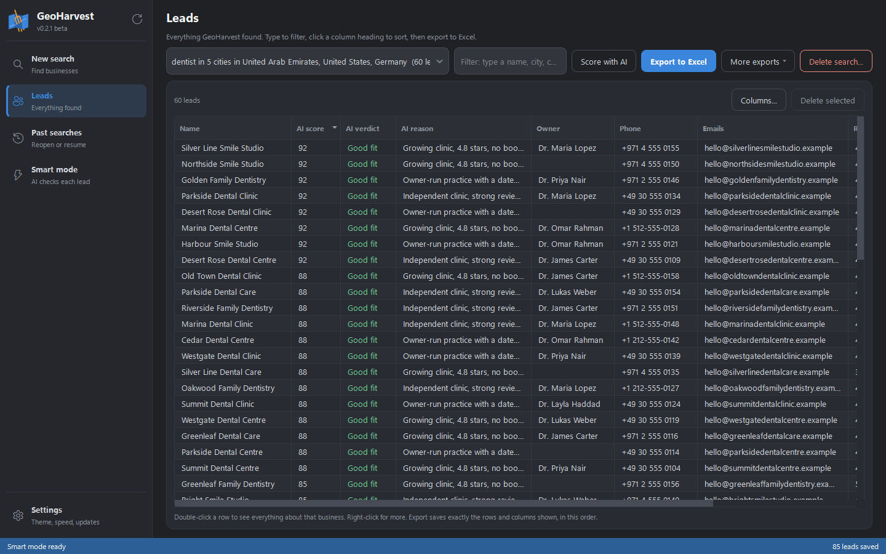
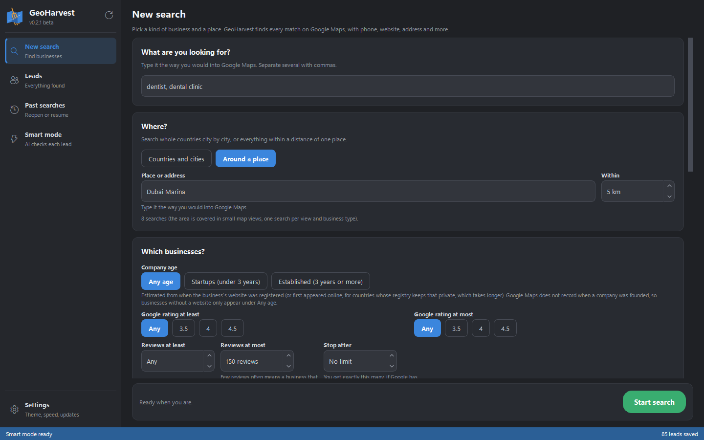
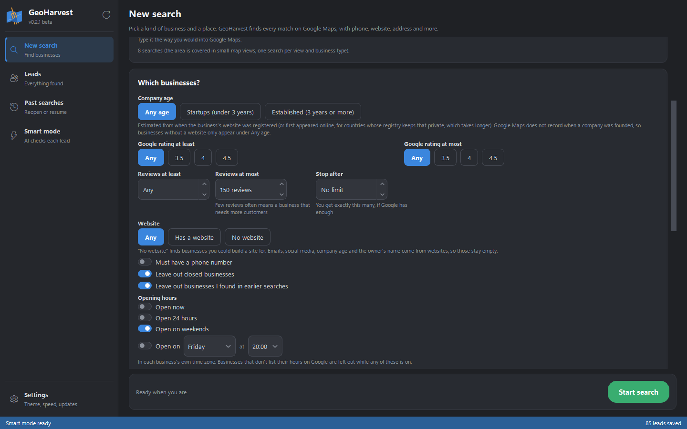
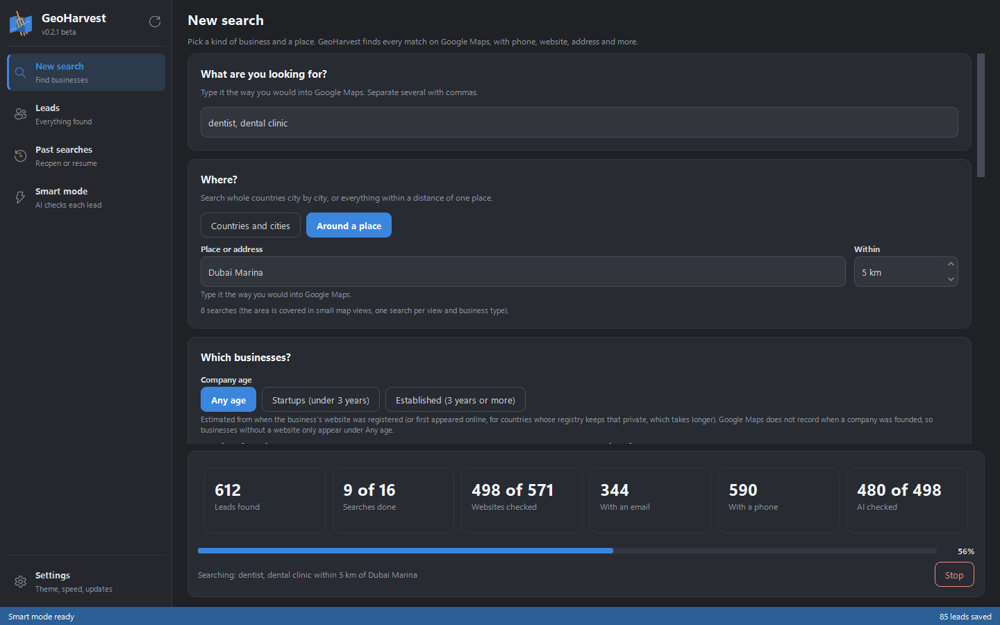
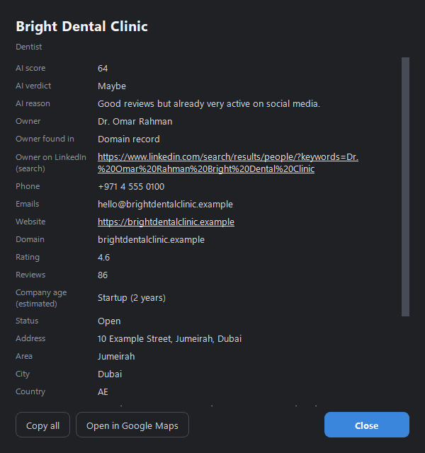
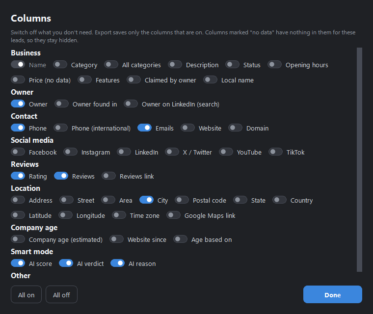
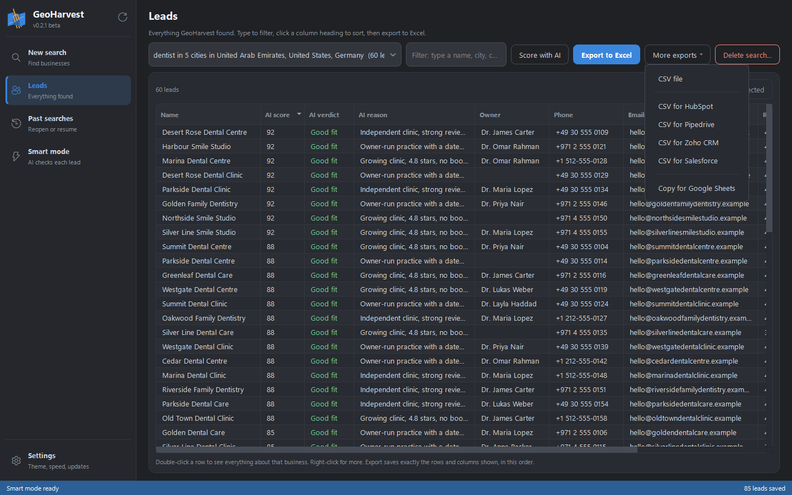
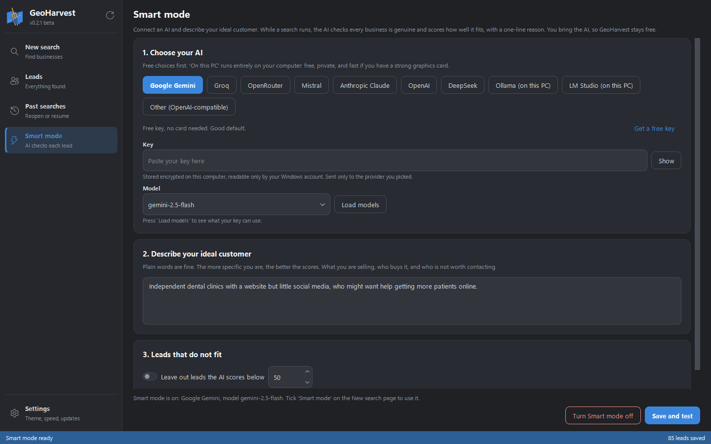
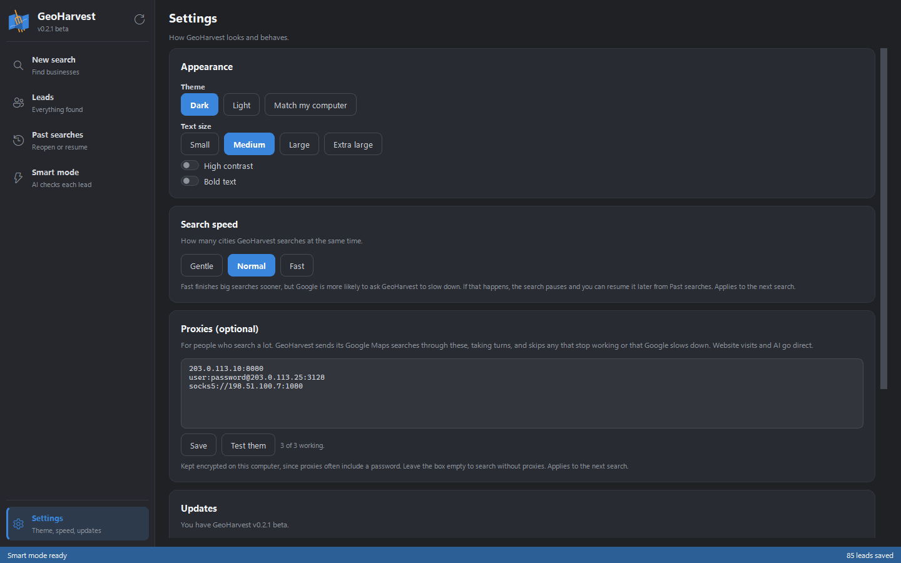
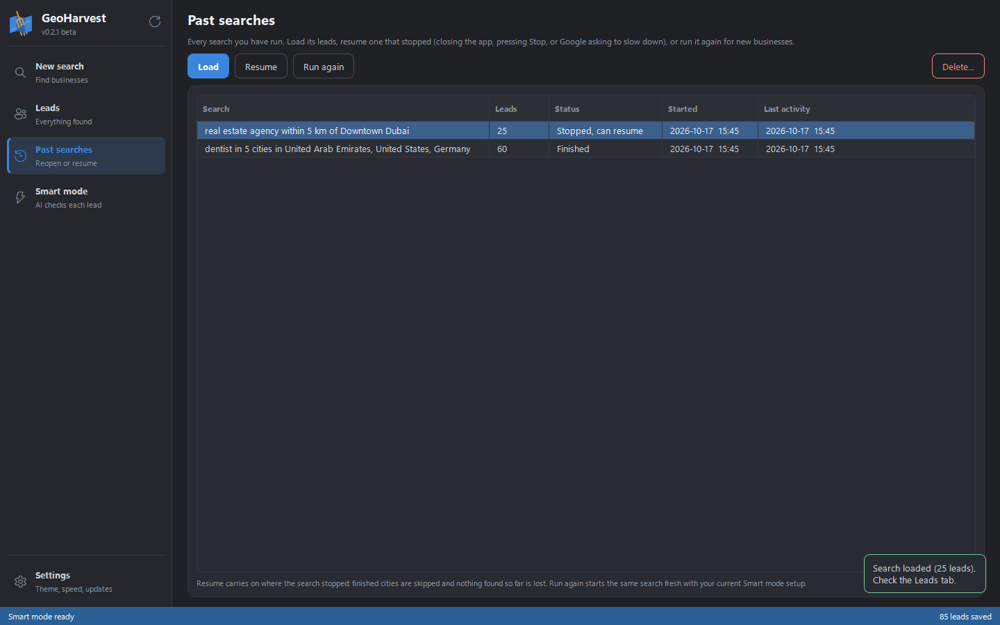

<p align="center"></p>

<h1 align="center">GeoHarvest</h1>

<p align="center"><b>Find business leads on Google Maps. Free, fast, and no API key needed.</b></p>

Tell GeoHarvest what kind of business you want and where: whole countries city by city, or
everything within a few kilometres of an address. It collects every match from Google Maps,
with name, phone, website, address, rating, reviews, opening hours and more. Then it visits
each business's website for **email addresses, social media and the owner's name**, estimates
**how old the company is**, and, if you connect an AI, **scores every lead** against your ideal
customer. Export to Excel, to your CRM, or straight into Google Sheets. No account, no
subscription, nothing to pay: everything runs on your own computer.

**Download:** [latest release](https://github.com/4bdulllahh/GeoHarvest/releases/latest) ·
**Version:** 0.2.1 (free beta) · **Works on:** Windows 10 and 11 · **Countries:** all of them

[](https://github.com/4bdulllahh/GeoHarvest/actions/workflows/build.yml)
[](https://github.com/4bdulllahh/GeoHarvest/releases/latest)
[](LICENSE)


<p align="center"></p>

> **Free while in beta.** Please [report anything confusing or broken](https://github.com/4bdulllahh/GeoHarvest/issues/new).
> The businesses and people in these screenshots are made up.

## Features

- **Any business, anywhere.** Type a niche (restaurant, dentist, real estate agency,
  consultancy...) or several at once, with suggestions as you type. Then choose where:
  - **Countries and cities.** Switch on the countries you want, including the whole
    **European Union** or the **Gulf (GCC)** in one click, then the cities in them. Any town
    that isn't listed can be added.
  - **Around a place.** Type an address or area ("Dubai Marina", "5th Avenue, New York") and a
    distance from 1 to 100 km. GeoHarvest finds it on the map, covers the circle in small map
    views and keeps only the businesses inside it.
- **Fast.** GeoHarvest asks Google Maps for results directly instead of driving a web browser
  and clicking every listing, and it searches several cities or map views at once. In testing
  it found 1,377 dentists across the Netherlands, the UAE and the US in 47 seconds, and every
  dentist within 3 km of Dubai Marina in 7 seconds.
- **More results.** Google's own map stops at about 120 places; GeoHarvest pages through to
  about 200 per city and business type, and an area search adds more by splitting the map.
- **Maximum detail on every lead.** Name, category, phone (local and international), website,
  rating, number of reviews, address split into street, area, city, postal code and country,
  map coordinates, opening hours, price level, description, features (wheelchair access,
  women-owned...), whether the owner has claimed the listing, and links to the Google Maps
  page and its reviews.
- **Emails and social media.** GeoHarvest reads each business's website (the home page and its
  contact, about and team pages) for email addresses and Facebook, Instagram, LinkedIn, X,
  YouTube and TikTok links. It decodes hidden ("protected") emails, puts the business's own
  addresses first and throws away template ones such as `you@example.com`.
- **The owner's name (optional).** It looks for the owner or founder on the website ("Founder:
  Jane Smith", "Jane Smith, Owner", the page's business data) and in the domain's registration
  record, and adds a ready-made **LinkedIn search link** for every lead so you can check.
- **Startup or established.** Google Maps doesn't record when a company was founded, so
  GeoHarvest estimates it from when the business's website was registered or first appeared
  online. Filter for **startups** (under 3 years) or **established** companies.
- **Filters that find the right businesses.**
  - Google rating **at least** and **at most**, reviews **at least** and **at most** (few reviews
    often means a business that needs more customers).
  - Website: **any, has one, or none**. "No website" finds businesses you could build a site for.
  - **Opening hours**: open now, open 24 hours, open on weekends, or open on a day and time you
    pick, each in the business's own time zone.
  - Must have a phone number, leave out closed businesses, leave out businesses you found in
    earlier searches, and stop after exactly as many leads as you want.
- **Only the details you need.** Switch off any column before a search (Details to include)
  or after it (Columns). Exports contain only the columns that are on.
- **Smart mode (optional).** Connect an AI and describe your ideal customer in plain words. The
  AI checks every business is genuine and gives it a score from 0 to 100, a verdict (Good fit,
  Maybe, Poor fit) and a one-line reason, and can leave out poor fits for you. Works with free
  AIs (Google Gemini, Groq, OpenRouter, Mistral), paid ones (Claude, OpenAI, DeepSeek) and
  **AI running on your own computer** (Ollama, LM Studio). You bring your own key; GeoHarvest
  has none built in.
- **Live results.** Leads appear while the search runs, with tiles counting leads, searches,
  websites checked, emails, phones and AI scores. Filter as you type and sort any column.
- **Everything about a business in one window.** Double-click a lead to see every detail, with
  clickable links, **Copy all** and **Open in Google Maps**.
- **Export anywhere.**
  - **Excel** with clickable links, or a plain **CSV**.
  - CSV files ready to import into **HubSpot, Pipedrive, Zoho CRM and Salesforce**, using each
    CRM's own column names.
  - **Copy for Google Sheets**: copies the leads and opens a new sheet; press Ctrl+V.
  - Safe against spreadsheet formula tricks hidden in business names.
- **Nothing is ever lost.** Every result is saved the moment it arrives. Stop a search, close
  the app, or have Google ask GeoHarvest to slow down, and **Resume** carries on exactly where
  it stopped.
- **Past searches.** Load any search's leads, resume it, run it again or delete it. Delete
  single leads you don't want.
- **Proxies (optional).** For people who search a lot: paste HTTP or SOCKS5 proxies in Settings
  and test them. GeoHarvest takes turns between them and skips any that stop working.
- **Updates itself.** When a new version comes out, GeoHarvest offers to install it, checks the
  download is genuine, and keeps all your searches and settings.
- **Light and easy to install.** A 32 MB download with its own installer: no administrator
  rights, no Python, nothing else to install, and Cancel never leaves a half-installed app.
- **Easy to read.** Dark, light or match-your-computer themes, four text sizes, high contrast,
  bold text, and on/off switches throughout.

## Screenshots

<p align="center"></p>

| Filters: rating, reviews, website and opening hours | A search running, with live tiles |
| --- | --- |
|  |  |

| Everything about one business | Columns: switch any detail on or off |
| --- | --- |
|  |  |

<p align="center"></p>

| Smart mode: your AI, your ideal customer | Settings: proxies, speed and appearance |
| --- | --- |
|  |  |

<p align="center"></p>

## How it works

1. **New search.** Type the kind of business. Choose **Countries and cities** or **Around a
   place**. Pick a company age, any filters and the details you want. Press **Start search**.
2. **Watch it work.** The tiles count leads, searches, websites checked, emails, phones and
   (in Smart mode) AI scores. Press **Stop** whenever you like; **Resume** in Past searches
   carries on later.
3. **Leads.** The page opens on your latest search. Filter, sort, double-click a lead for its
   details, delete the ones you don't want, and use **Columns** to choose what shows.
4. **Export.** **Export to Excel**, or **More exports** for CSV, your CRM or Google Sheets. The
   export has exactly the rows and columns on screen, in that order.

### Smart mode

1. Open **Smart mode** and choose an AI. **Google Gemini** is a good free start: press **Get a
   free key**, sign in with a Google account, copy the key and paste it in. For a free,
   private AI on your own PC, install [Ollama](https://ollama.com/download), run
   `ollama pull llama3.2`, and choose **Ollama (on this PC)**.
2. Press **Load models** and pick one.
3. Describe your ideal customer: what you sell, who buys it and who is not worth contacting.
4. Press **Save and test**. GeoHarvest asks the AI to score a sample business, so you know it
   works before a real search.
5. Switch on **Smart mode** on the New search page. To score a search you already ran, open it
   on the Leads page and press **Score with AI**.

## Install

1. Download `GeoHarvest-vX.Y.Z-windows.zip` from the
   [latest release](https://github.com/4bdulllahh/GeoHarvest/releases/latest).
2. Right-click it and choose **Extract All** (Setup can't run from inside the zip).
3. Open the extracted folder, double-click **GeoHarvest-Setup.exe** and click **Install**. At
   the end, choose the Start menu entry, a desktop shortcut and whether GeoHarvest opens when
   Windows starts. No administrator rights needed.

**"Windows protected your PC"?** GeoHarvest is new and not yet code-signed (a signing
certificate costs money every year), so Windows SmartScreen doesn't recognise it. Press
**More info**, then **Run anyway**. You only need to do this once.

Your searches, leads and settings are kept in `%APPDATA%\GeoHarvest`, outside the app folder,
so updating never loses them. To remove GeoHarvest, use **Settings > Uninstall GeoHarvest** or
Windows Settings > Apps; it asks whether to keep your data.

## Privacy

GeoHarvest has no accounts, no servers of its own, no analytics and no tracking. Everything
stays in `%APPDATA%\GeoHarvest` on your computer, and your AI key and proxies are encrypted so
only your Windows account can read them. It connects only to Google Maps, the websites of the
businesses it finds, domain-record and web-archive lookups, the AI you choose (which never
receives emails, phone numbers or owners' names) and GitHub for updates. The full list is in
[PRIVACY.md](PRIVACY.md).

## Principles

- **Free for good.** No paid APIs, no proxies you have to buy, no subscription. You bring the AI
  if you want one.
- **Nothing slow on screen.** Searching, website visits, AI and exports all run in the
  background, so the window never freezes.
- **Never lose a result.** Every page of results is saved as it arrives, and every search can
  be resumed.
- **Plain English.** No jargon on screen; every setting says what it does.
- **The logic is tested without the UI.** `app/core` never touches the interface, and its
  tests run without a network.

## Tech stack

| Area | Choice |
| --- | --- |
| Language | Python 3.12 |
| Interface | PyQt6 (Qt 6 Widgets), Fusion style, one stylesheet with dark and light themes |
| Google Maps | Plain HTTPS with httpx (no browser, no API key), HTTP and SOCKS5 proxies |
| Websites | httpx, 16 at a time; RDAP for domain age and registrant, the Wayback Machine as a fallback |
| Smart mode | Google Gemini and OpenAI-compatible services over HTTPS, Claude through the official `anthropic` SDK |
| Storage | SQLite, one JSON document per lead; keys and proxies encrypted with Windows DPAPI |
| Export | openpyxl for Excel, Python's csv for CSV and CRM files |
| Installer | Its own, written in Python with Tkinter, built with PyInstaller (one folder, not one file) |
| Quality | pytest (no network needed), a packaged self-test, GitHub Actions on every push |

## How a search works

The Google Maps page fetches its result list as JSON from `google.com/search?tbm=map&pb=...`,
20 places at a time. GeoHarvest sends the same request, with the long `pb` parameter
captured from a real browser session, and pages through until Google runs out (about 200
places).

- **Countries and cities** become one query per city and business type ("dentist in Dubai,
  United Arab Emirates"), run several at a time.
- **Around a place**: GeoHarvest first asks Google where the place is. It then covers the
  circle with map views at most 5 km across (up to 8 x 8), searches each one with the map put
  there, stops paging a view as soon as a page has nothing inside it, and keeps only the
  businesses inside the circle.
- **Filters** that need only Google's data (rating, reviews, website, phone, opening hours,
  closed businesses) are applied as results arrive. Website visits, company age and the AI
  score run alongside, and "Stop after" counts only the leads that are kept.
- **Opening hours** are read from Google's text ("Monday: 9 AM-5 PM; Friday: 6 PM-2 AM...")
  and checked in the business's own time zone, including late nights that run past midnight.

## Good to know

- **Results per search.** Google shows about 200 businesses per city and business type. For
  more leads, choose more cities, use Around a place, or add business types (`dentist, dental
  clinic, orthodontist`).
- **"Google asked GeoHarvest to slow down."** Very large searches from one internet connection
  can hit Google's limits. GeoHarvest pauses, keeps everything found, and you can resume from
  Past searches after about 15 minutes. **Gentle** speed in Settings, or proxies, make this
  less likely.
- **Company age is an estimate** based on the website's domain. Some registries (`.pk`, `.de`)
  don't publish dates; for those GeoHarvest uses the first time the site appeared in the
  Internet Archive, which is slower, so it only does that when you filter by age.
- **Owners' names** are found only when the website or the domain record states them, so
  expect them for some businesses, not all.
- **Emails** come from the business's own website. Businesses with only a Facebook or
  Instagram page get that link but no email, because those sites block automated visits.

## Testing the beta

The most useful feedback: what you searched for and what went wrong or looked odd, anything
confusing, and what you wish it did. Post it as a
[GitHub issue](https://github.com/4bdulllahh/GeoHarvest/issues/new). If the app crashed,
attach `%APPDATA%\GeoHarvest\logs\crash.log`; if Setup failed, attach
`%TEMP%\GeoHarvest-setup-log.txt` (Setup's **Open log file** button shows it).

## Run from source

```
git clone https://github.com/4bdulllahh/GeoHarvest
cd GeoHarvest
pip install -r requirements-dev.txt
python run.py                      # run the app
python -m pytest tests/ -q         # tests (no network needed)
python tools/build.py              # dist/GeoHarvest-vX.Y.Z-windows.zip (installer inside), self-tested
python tools/screenshot.py         # these README screenshots, from made-up demo data
```

Publishing a release on GitHub builds the zip and attaches it automatically
(`.github/workflows/build.yml`). [HANDOVER.md](HANDOVER.md) explains how everything works, the
decisions behind it, and where each feature lives.

## Roadmap

- [x] **1. Shell**: the window, theme, sidebar and logo
- [x] **2. Search engine**: Google Maps search without a browser, city by city, saved as it goes
- [x] **3. Search and Leads**: the search form, live table, filters, Excel and CSV export
- [x] **4. Enrichment**: emails and social links from websites, company age
- [x] **5. Smart mode**: AI lead scoring with free, paid and on-your-PC AIs
- [x] **6. History and updates**: past searches, resume, auto-update, settings, every country
- [x] **7. Release**: the Windows download, automatic builds, this README (v0.1.0)
- [x] **v0.1.1 and v0.1.2**: our own installer, uninstall, exact lead counts, a Stop that stops
- [x] **v0.2**: a fixed and faster installer, a smaller download, lead details, deleting leads,
  choosing columns, Load from Past searches
- [x] **v0.2.1**: search around a place, rating and reviews at most, website any/has/none,
  opening hours, owners' names, Columns, CRM exports, Copy for Google Sheets, proxies, switches
- [ ] **Ideas for later**: more languages in the app, emails from Facebook pages, a map view of
  results, and a Mac version

## Legal

- [LICENSE](LICENSE): GeoHarvest's code is MIT licensed.
- [THIRD-PARTY-NOTICES.md](THIRD-PARTY-NOTICES.md): the libraries and data GeoHarvest uses and
  their licenses. The Windows download includes PyQt6, so the download as a whole is
  distributed under the GPL v3.
- [PRIVACY.md](PRIVACY.md): what is stored, and what is sent where.
- [DISCLAIMER.md](DISCLAIMER.md): acceptable use, data protection and marketing laws, and no
  warranty. GeoHarvest is not affiliated with Google.
- [SECURITY.md](SECURITY.md): how to report a security problem.

## License

[MIT](LICENSE) © 2026 Abdullah
